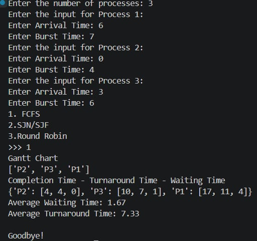
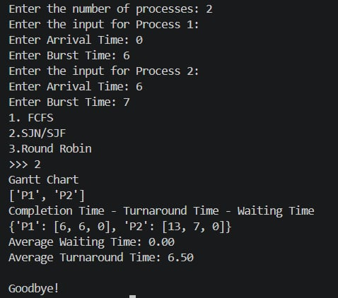
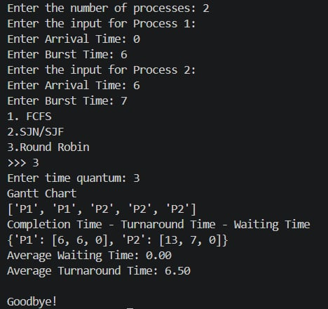

# CPU Scheduling Algorithm Simulator

A Python-based simulation of CPU scheduling algorithms for the MINIOS project. This program demonstrates three fundamental CPU scheduling techniques used in operating systems to manage process execution.

## Submitted to
**Ms. Angelika S. Balagot**

## Developers
- Cara, Jedric Ray
- Flores, Gino Angelo
- Patarata, John Paul
- Pineda, Charles Vernard
- Valdez, Kian

## Project Overview

This simulator implements three classic CPU scheduling algorithms:

## Scheduling Algorithms

### 1. **FCFS (First Come, First Served)**
- **Type**: Non-preemptive
- **Description**: Processes are executed in the order they arrive in the ready queue
- **Advantages**: Simple and easy to implement
- **Disadvantages**: May cause convoy effect (short processes wait for long ones)



### 2. **SJF (Shortest Job First)**
- **Type**: Non-preemptive
- **Description**: The process with the smallest burst time is selected for execution
- **Advantages**: Optimal average waiting time
- **Disadvantages**: Requires knowledge of future burst times; may cause starvation of longer processes



### 3. **Round Robin**
- **Type**: Preemptive
- **Description**: Each process gets a fixed time slice (time quantum) for execution. Processes are executed in circular order
- **Advantages**: Fair allocation of CPU; good response time
- **Disadvantages**: Performance depends on time quantum size



## Features

- Interactive input for process details (arrival time, burst time)
- Gantt chart visualization for each algorithm
- Performance metrics calculation:
  - Completion Time
  - Turnaround Time
  - Waiting Time
  - Average Waiting Time
  - Average Turnaround Time

## How to Run

1. Ensure you have Python installed (Python 3.x recommended)
2. Run the program:
   ```bash
   python CPUSchedulingAlgorithm.py
   ```
3. Enter the number of processes
4. For each process, provide:
   - Arrival Time
   - Burst Time
5. Select the scheduling algorithm:
   - `1` for FCFS
   - `2` for SJF
   - `3` for Round Robin
6. If Round Robin is selected, enter the time quantum

## Input Format

For each process, you need to provide:
- **Process ID**: Automatically assigned (P1, P2, P3, ...)
- **Arrival Time**: When the process enters the ready queue
- **Burst Time**: The CPU time required by the process

## Output

The program displays:
- **Gantt Chart**: Visual representation of process execution order
- **Completed Processes**: Dictionary showing completion time, turnaround time, and waiting time for each process
- **Average Waiting Time**: Mean time processes spend waiting in the ready queue
- **Average Turnaround Time**: Mean time from process submission to completion

## Example Usage

```
Enter the number of processes: 3
Enter the input for Process 1:
Enter Arrival Time: 0
Enter Burst Time: 10
Enter the input for Process 2:
Enter Arrival Time: 1
Enter Burst Time: 5
Enter the input for Process 3:
Enter Arrival Time: 2
Enter Burst Time: 8
1. FCFS
2.SJN/SJF
3.Round Robin
>>> 1
```

## Course Information

**Course**: INTECH 2201

## Notes

- All processes are assumed to have unique IDs (P1, P2, P3, ...)
- The program handles cases where the CPU is idle (no processes available)
- Round Robin uses a time quantum specified by the user
- The simulator outputs results to the console
